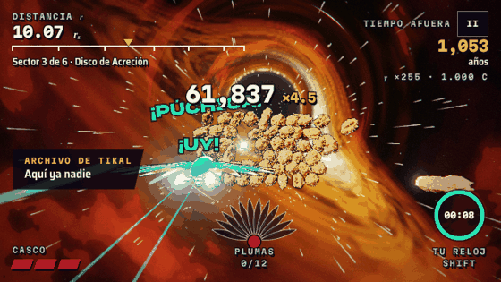
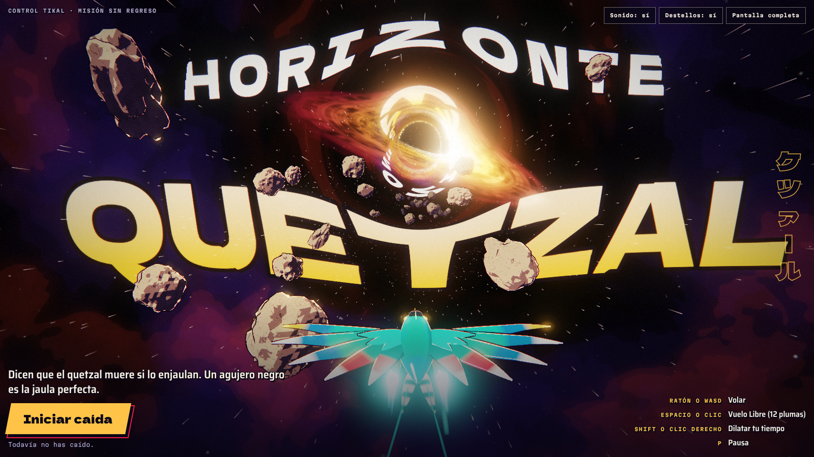
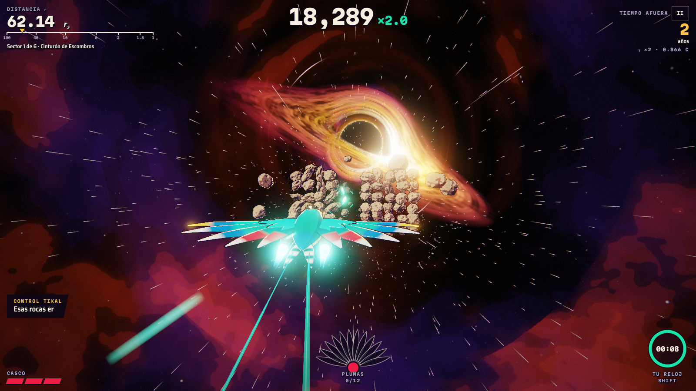
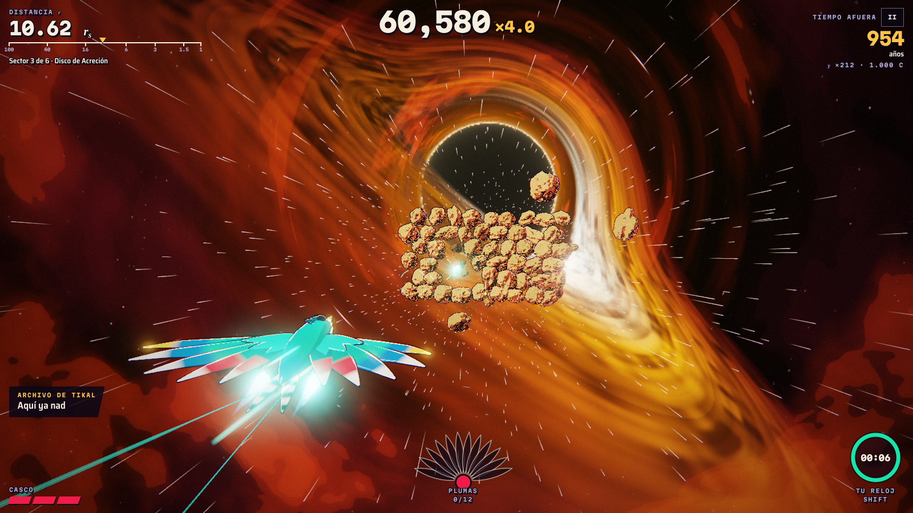
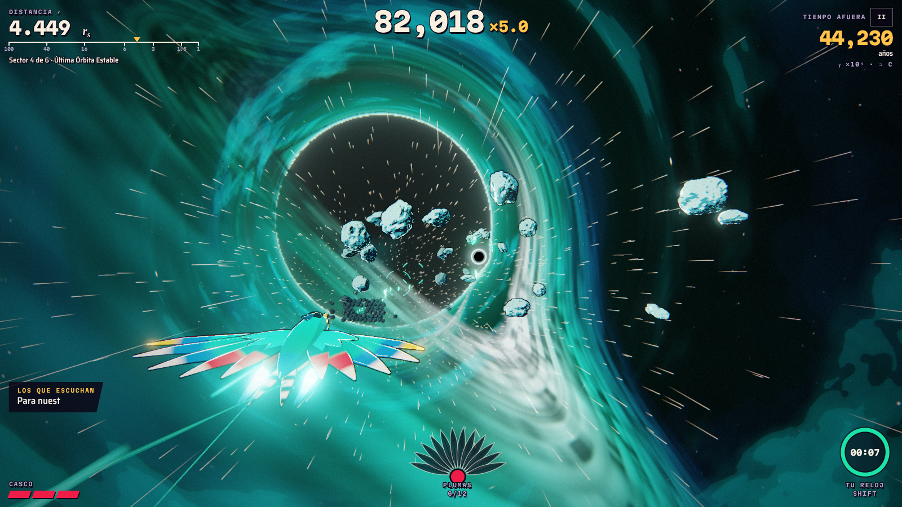
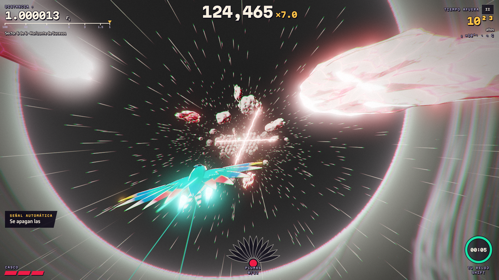
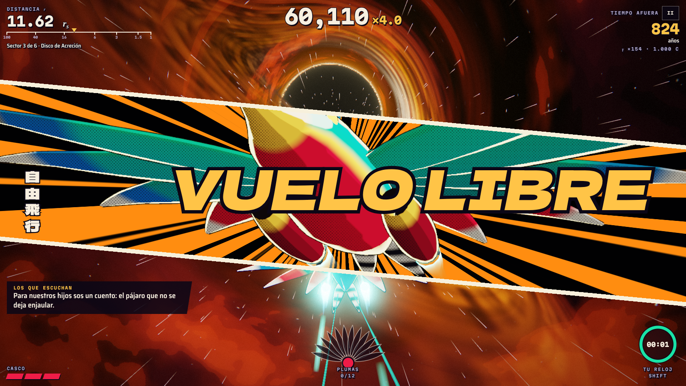
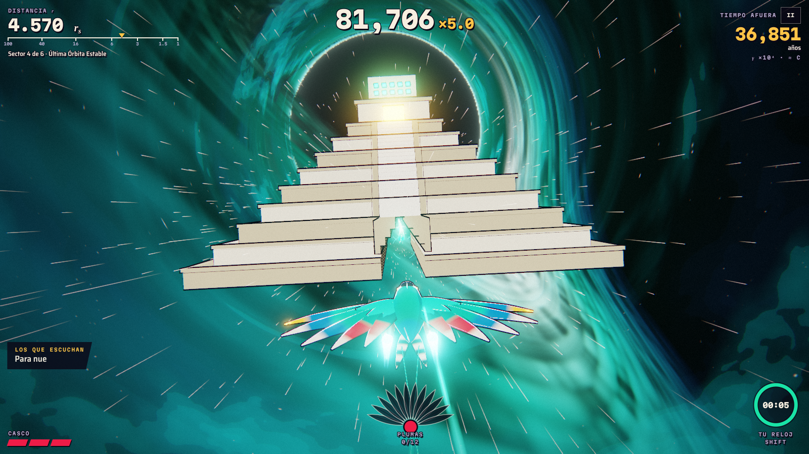
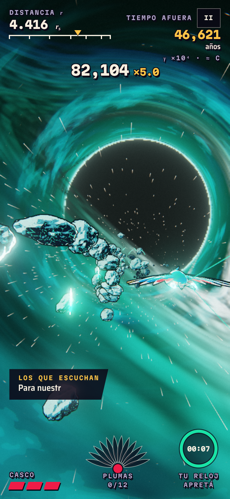

<div align="center">

# Horizonte Quetzal

**Dicen que el quetzal muere si lo enjaulan. Un agujero negro es la jaula perfecta.**

Juego 3D para el navegador: pilotás un quetzal que cae hacia un agujero negro esquivando rocas, mientras afuera pasan millones de años.

[**▶ Jugar ahora**](https://gersoncode-prog.github.io/horizonte-quetzal/)




</div>

## De qué se trata

Mientras más hondo caés, más rápido corre el tiempo afuera. Para vos pasan segundos; allá pasan generaciones. Tu familia te escribe primero, después sus descendientes, y al final solo queda una señal automática.

Si sobrevivís unos 5 minutos, llegás a cruzar el horizonte de sucesos.



## Los seis sectores

Cada sector usa una zona real de un agujero negro, medida en radios de Schwarzschild (rₛ).

| # | Sector | r (rₛ) | Lo nuevo |
|---|--------|--------|----------|
| 1 | Cinturón de Escombros | 100 → 40 | Campos de rocas, cortinas y espirales |
| 2 | Límite de Roche | 40 → 16 | Rocas que se parten y rocas gigantes |
| 3 | Disco de Acreción | 16 → 6 | Arcos de plasma |
| 4 | Última Órbita Estable | 6 → 3 | Micro agujeros que te jalan |
| 5 | Esfera de Fotones | 3 → 1.5 | Un eco de tu nave que repite tu camino |
| 6 | Horizonte de Sucesos | 1.5 → 1 | Todo junto, en blanco y negro; solo vos conservás el color |

<table>
  <tr>
    <td></td>
    <td></td>
  </tr>
  <tr>
    <td></td>
    <td></td>
  </tr>
</table>

## Cómo se juega

No hay disparos: se esquiva. Pasar pegadito a las rocas sube tu multiplicador.

| Acción | Computadora | Celular |
|--------|-------------|---------|
| Volar | Ratón o WASD / flechas | Arrastrar el dedo |
| Vuelo Libre (12 plumas) | Espacio, E o clic | Tocar el abanico |
| Dilatar el tiempo | Shift, Q o clic derecho | Dejar apretado el reloj |
| Pausa | P o Esc | Botón II |
| Silenciar | M | Botón de sonido en el título |

- **Vuelo Libre:** durante 6.5 segundos nada te hace daño y rompés lo que chocás.
- **Dilatar el tiempo:** todo va más lento para vos, y afuera los años corren más rápido.
- **Casco:** aguantás 3 golpes. Las plumas doradas lo reparan.

<table>
  <tr>
    <td width="66%"><br></td>
    <td></td>
  </tr>
</table>

## Cómo está hecho

- **Agujero negro:** un shader traza la trayectoria de la luz alrededor del agujero. De ahí salen el lente gravitacional, el anillo de fotones y el disco más brillante de un lado (efecto Doppler). El título y los nombres de sector pasan por el mismo lente.
- **Estilo anime:** rocas con sombreado cel, trama de manga y contorno de tinta sobre un fondo pintado, con líneas de velocidad y cuadros de impacto en blanco y negro.
- **Render:** bloom propio y resolución que baja sola si la máquina no alcanza.
- **Audio:** toda la música y los efectos se generan en el navegador con Web Audio; la melodía es una marimba. No hay archivos de sonido.
- **Interfaz:** anime.js anima el HUD y los textos; Tailwind CSS acomoda la interfaz.

Los gráficos también son procedurales: la nave, las rocas y el templo se generan con código, sin modelos ni texturas externas.

## Correrlo en tu máquina

Es un solo archivo, sin instalación ni compilación:

```bash
git clone https://github.com/GersonCode-prog/horizonte-quetzal.git
cd horizonte-quetzal
```

Después abrí `index.html` en el navegador. Necesitás internet porque las librerías y las fuentes se cargan desde CDN.

**Requisitos:** un navegador con WebGL2 (Chrome, Firefox, Safari o Edge normal; no funciona en modo Internet Explorer).

## Accesibilidad

El juego tiene destellos a pantalla completa. Se apagan con el botón **Destellos**, y arrancan apagados si tu sistema pide reducir el movimiento.

## Modo de pruebas

Abrí la página con `#hq-debug` al final de la dirección y usá la consola:

```js
__HQ.G.god = true;     // sin daño
__HQ.jump(3);          // saltar de sector (0 a 5)
__HQ.G.feathers = 12;  // Vuelo Libre listo
```

## Licencia

[MIT](LICENSE). Three.js, anime.js y Tailwind CSS se cargan desde CDN y conservan sus propias licencias.
